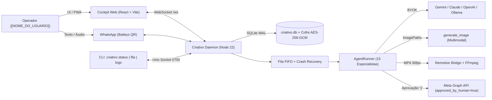

# CriativoOS

Plataforma autônoma **multi-agente** (24/7) para criação, revisão e publicação de conteúdo criativo para Instagram — carrosséis, posts individuais, anúncios, stories 9:16 e vídeos cinematográficos Remotion — operada via **Cockpit Web**, **WhatsApp (QR Code)**, **Telegram** e **CLI Linux**.

> Template de produto agnóstico para a marca `[NOME_DA_MARCA]` (`[@SEU_PERFIL]`). Nenhuma chave de API ou dado pessoal real é incluído no repositório.

---

## Arquitetura & Fluxo Ponta a Ponta



### Principais Pilares Técnicos
- **Daemon Autônomo 24/7 (`apps/daemon`)**: Servidor HTTP + WebSocket nativo (RFC 6455), Fila FIFO priorizada, Cron Scheduler (`America/Sao_Paulo`), recuperação automática pós-crash (`recoverInterruptedTasks`) e servidor de controle via Unix Socket (`/run/criativo/control.sock` com permissão `0700`) ou Named Pipe no Windows.
- **Cofre BYOK Criptografado (`AES-256-GCM`)**: Suas chaves de API ficam cifradas localmente no SQLite com salt e IV únicos por registro derivados via `scrypt` da variável `CRIATIVO_VAULT_KEY`.
- **Geração Multimodal Real (`generate_image`)**: Os designers chamam nativamente Gemini (`gemini-2.5-flash-image-preview`), OpenAI (`gpt-image-1`) ou Flux enviando fotografias reais e logos via `ImagePaths` para preservar consistência biométrica facial e margens seguras, nunca gerando artes genéricas descartáveis.
- **Invariante de Segurança Meta API**: A ferramenta `meta_publicar` bloqueia qualquer publicação automática caso `approved_by_human !== true`. Nenhuma postagem entra no Instagram sem aprovação explícita no Cockpit Web ou respondendo `1` no WhatsApp.

---

## Roster Completo dos 15 Agentes Especialistas

### Frente 1 — 9 Agentes Base de Conteúdo
| Ordem | `agente_id` | Especialista | Papel Principal | Modelo Padrão |
| :--- | :--- | :--- | :--- | :--- |
| 1 | `estrategista` | Estrategista Editorial | Calendário editorial, pilares, pautas e formatos | `gemini-2.5-pro` |
| 2 | `copywriter` | Copywriter de Resposta Direta | Ganchos magnéticos, slides AIDA/PAS, legendas e CTAs | `claude-3-7-sonnet-latest` |
| 3 | `designer_individual` | Designer de Post Individual | Direção de arte generativa 1080×1350 (`3:4`) | `gemini-2.5-pro` |
| 4 | `designer_carrossel` | Designer de Carrosséis | Narrativas contínuas de 4 a 10 slides em `3:4` | `gemini-2.5-pro` |
| 5 | `designer_ads` | Designer de Anúncios (Ads) | Criativos estáticos A/B de alta conversão para Meta Ads | `gpt-4o` |
| 6 | `designer_stories` | Designer de Stories | Layouts verticais 9:16 (1080×1920) com zonas seguras | `gemini-2.5-flash` |
| 7 | `diretor_identidade` | Diretor de Identidade Visual | Brandbook, design system, paleta e tokens visuais | `claude-3-7-sonnet-latest` |
| 8 | `engenheiro_meta` | Engenheiro de Integração & Meta | Validação e publicação oficial Meta Graph API | `gemini-2.5-flash` |
| 9 | `analista_metricas` | Analista de BI & Métricas | Análise de alcance, salvamentos e retroalimentação | `gemini-2.5-pro` |

### Frente 2 — 3 Agentes Bônus de Escala
| Ordem | `agente_id` | Especialista | Papel Principal | Modelo Padrão |
| :--- | :--- | :--- | :--- | :--- |
| 10 | `diretor_entregaveis` | Diretor de Operações & Entregáveis | Pacotes executivos, CSV editorial e vitrines | `claude-3-7-sonnet-latest` |
| 11 | `inteligencia_competitiva` | Diretor de Inteligência Competitiva | Engenharia reversa de mercado e brechas competitivas | `gemini-2.5-pro` |
| 12 | `consistencia_visual` | Engenheiro de Consistência Visual | Folha 360° de personagem e âncoras faciais `ImagePaths` | `gemini-2.5-pro` |

### Frente 3 — 3 Agentes de Vídeo Cinematográfico (Remotion)
| Ordem | `agente_id` | Especialista | Papel Principal | Modelo Padrão |
| :--- | :--- | :--- | :--- | :--- |
| 13 | `editor_video` | Diretor & Editor de Vídeo | Renderização Remotion 1080×1920 a 30fps com legendas karaokê | `gemini-2.5-pro` |
| 14 | `roteirista_faceless` | Roteirista Faceless | Roteiros cena a cena para B-rolls e narrações IA | `claude-3-7-sonnet-latest` |
| 15 | `roteirista_talking_head` | Roteirista Talking Head | Roteiros teleprompter com ganchos de fala nos primeiros 3s | `claude-3-7-sonnet-latest` |

---

## Conexão com WhatsApp por QR Code (Baileys)

1. Inicie o daemon e acesse o Cockpit Web (`http://localhost:3000` ou `https://[SEU_DOMINIO]`).
2. Clique em **Conectar WhatsApp** na barra lateral ou envie `POST /api/mensageria/whatsapp/conectar`.
3. O evento WebSocket `whatsapp:status` exibirá o **QR Code em Base64** diretamente no modal de pareamento.
4. No seu celular, abra **WhatsApp → Aparelhos Conectados → Conectar um aparelho** e escaneie o código.
5. As credenciais criptográficas são salvas diretamente no SQLite (`useSqliteAuthState`) — sobrevivendo a reinicializações da VPS.

**Fluxo de Operação pelo WhatsApp:**
- Envie um **texto** ou **áudio OGG/Opus** (transcrito automaticamente via Gemini ou Whisper), por exemplo: *"Crie um carrossel sobre produtividade para [@SEU_PERFIL]"*.
- Quando os agentes finalizarem as artes/vídeo, o sistema envia as prévias no WhatsApp com o menu:
  - Responda **`1`** (ou `aprovar` / `sim`) para publicar oficialmente na Meta Graph API.
  - Responda **`2 <seu feedback>`** (ou `ajustar <feedback>`) para devolver a tarefa com correções à fila FIFO.

*(Opcional)* O módulo complementar Telegram (`TELEGRAM_BOT_TOKEN` + `TELEGRAM_CHAT_ID`) envia notificações espelhadas com botões inline de aprovação/ajuste.

---

## Guia de Configuração de Chaves (BYOK)

As chaves podem ser cadastradas via **Cockpit Web → Cofre de Segredos** ou via API REST (`POST /api/vault/salvar`):

| Chave no Cofre | Uso Principal | Obrigatória |
| :--- | :--- | :--- |
| `GEMINI_API_KEY` ou `GOOGLE_API_KEY` | Modelos Gemini 2.5, transcrição de áudio WhatsApp e `generate_image` | Recomendada |
| `CLAUDE_API_KEY` ou `ANTHROPIC_API_KEY` | Modelos Claude (Copywriter, Identidade, Roteiristas) | Opcional |
| `OPENAI_API_KEY` | Modelos GPT-4o, `gpt-image-1`, Whisper e OpenAI TTS | Opcional |
| `GROK_API_KEY` | Modelos xAI Grok | Opcional |
| `FAL_API_KEY` ou `FLUX_API_KEY` | Geração de imagens via Flux Pro (Fal.ai) | Opcional |
| `ELEVENLABS_API_KEY` | Narração MP3 ultra-realista para Reels (fallback gratuito: `edge-tts`) | Opcional |
| `META_ACCESS_TOKEN` e `META_IG_USER_ID` | Publicação oficial no Instagram via Meta Graph API v27.0 | Para publicar |
| `TELEGRAM_BOT_TOKEN` e `TELEGRAM_CHAT_ID` | Alertas e botões inline no Telegram | Opcional |

Exemplo via `curl` local:
```bash
curl -X POST http://127.0.0.1:3000/api/vault/salvar \
  -H "Content-Type: application/json" \
  -d '{"chave_nome":"GEMINI_API_KEY","valor":"[A PREENCHER]"}'
```

---

## Instalação na VPS em 1 Comando (Ubuntu 24.04 LTS)

Após clonar este repositório na sua VPS (`https://[SEU_DOMINIO]`), execute como root:

```bash
sudo bash scripts/install-vps.sh
```

O instalador automatizado executa:
1. Instala **Node.js 22 LTS**, **FFmpeg**, **Chromium** e **SQLite**.
2. Cria o usuário de sistema sem privilégios `criativo`.
3. Compila os workspaces (`contracts`, `whatsapp`, `daemon` e `apps/web`).
4. Gera automaticamente uma chave mestra aleatória `CRIATIVO_VAULT_KEY` em `/etc/criativo/criativo.env` (`chmod 600`).
5. Instala e habilita o serviço **`systemd`** (`/etc/systemd/system/criativo.service`) com reinício automático (`Restart=always`) e registra a CLI global em `/usr/local/bin/criativo`.

### Deploy Alternativo com Docker Compose
```bash
export CRIATIVO_VAULT_KEY="sua-chave-mestra-forte-32-bytes"
docker compose -f docker/docker-compose.yml up -d --build
```
Os dados e o banco SQLite `/data/criativo.db` ficam persistidos no volume Docker `criativo_dados`.

---

## Comandos da CLI (`criativo`)

Na VPS instalada via `install-vps.sh`, gerencie o estúdio diretamente pelo terminal (comunicação segura via Unix Socket sem expor portas adicionais):

```bash
criativo status     # Uptime, CPU, memória RSS, agentes ativos, fila e status WhatsApp
criativo fila       # Tabela formatada das tarefas na fila FIFO
criativo whatsapp   # Estado JSON da sessão Baileys / QR Code
criativo logs       # Logs ao vivo do serviço systemd (journalctl -u criativo.service -f)
criativo reiniciar  # Reinicialização graciosa do daemon
```

---

## Desenvolvimento Local & Testes (Desktop)

**Pré-requisitos:** Node.js `>= 22.0.0` (com `node:sqlite` nativo).

```bash
# 1. Instalar dependências do monorepo
npm install

# 2. Compilar TypeScript (contracts, whatsapp, daemon) e Cockpit Web (Vite)
npm run build
npm run build --workspace=apps/web

# 3. Iniciar o Daemon + Cockpit Web integrado em http://127.0.0.1:3000
npm run start:daemon

# 4. Rodar suítes de testes (Daemon, Cockpit Web e E2E)
npm run test:daemon
npm run test --workspace=apps/web
npm run test:e2e
```
